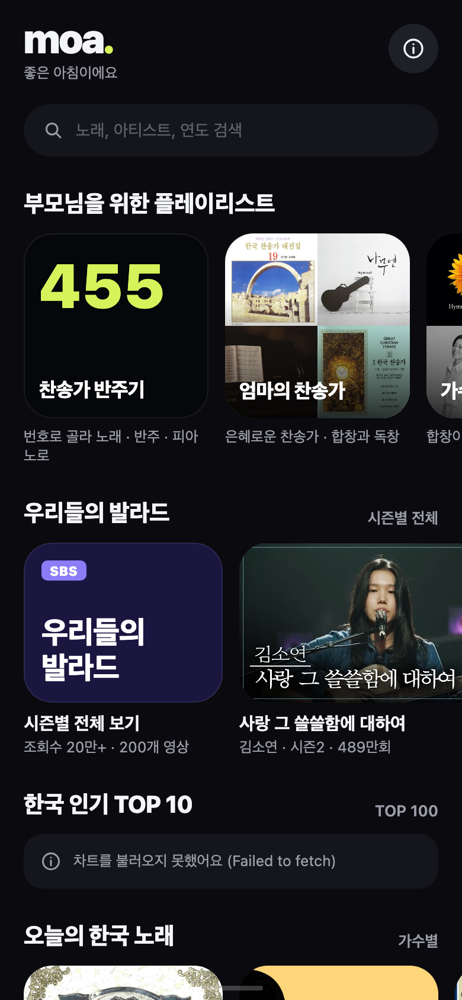
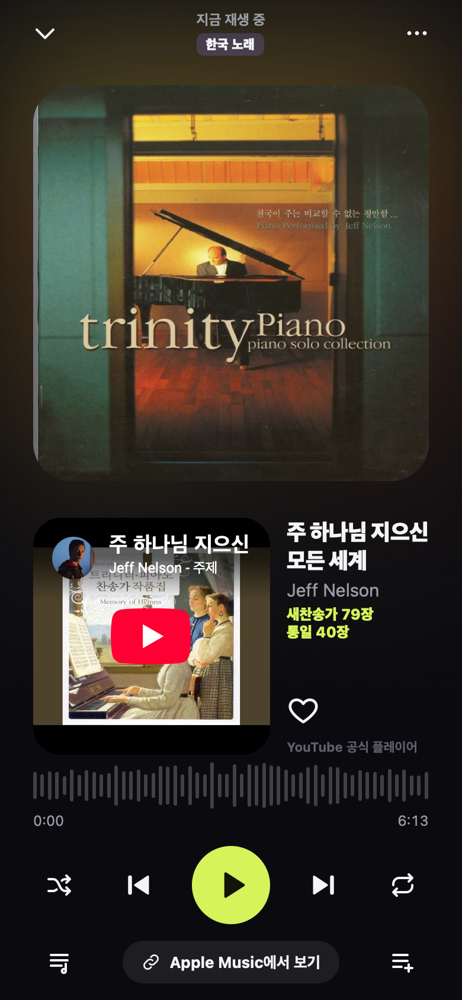
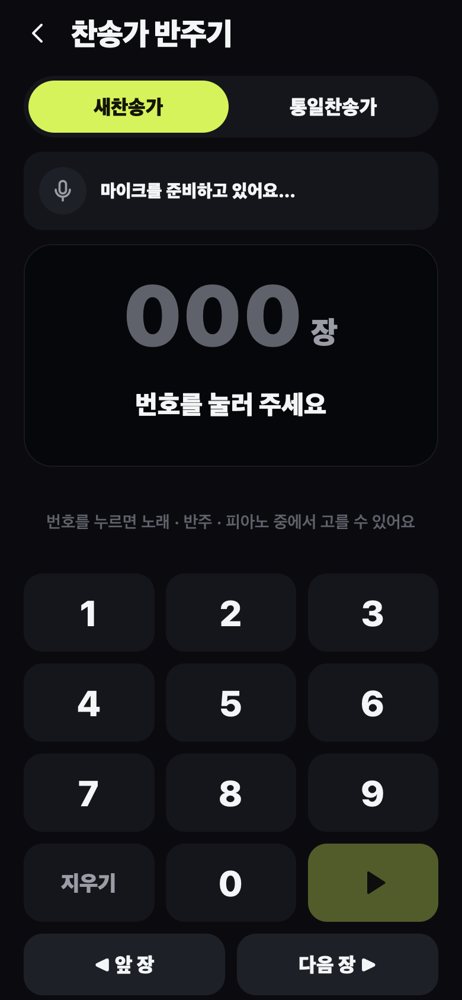
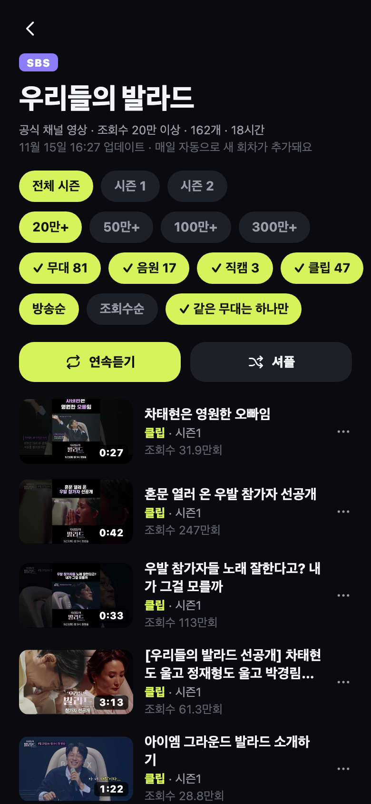

# moa — 무료 음악 앱

7080 가요, 찬송가, 우리들의 발라드를 무료로 들어요.

## ▶ [moa 받기 — damho0514.github.io/moa-music-releases](https://damho0514.github.io/moa-music-releases/)

| 기기 | 방법 |
|---|---|
| **웹 (PC · 맥 · 휴대폰)** | [**지금 바로 듣기**](https://moa.voxel-valley-server.workers.dev/): 설치가 필요 없어요. |
| **안드로이드** | [**moa.apk 내려받기**](https://github.com/damho0514/moa-music-releases/releases/latest/download/moa.apk): 파일을 열고 *출처를 알 수 없는 앱 설치*를 허용해요. |
| **아이폰** | Safari로 [moa](https://moa.voxel-valley-server.workers.dev/)를 열고 **공유 → 홈 화면에 추가**를 눌러요. 앱처럼 전체 화면으로 열려요. |

모든 버전은 [Releases](https://github.com/damho0514/moa-music-releases/releases)에 있어요.

   

